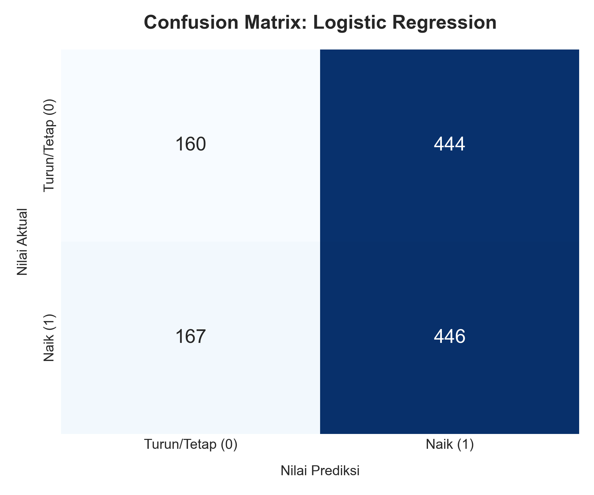
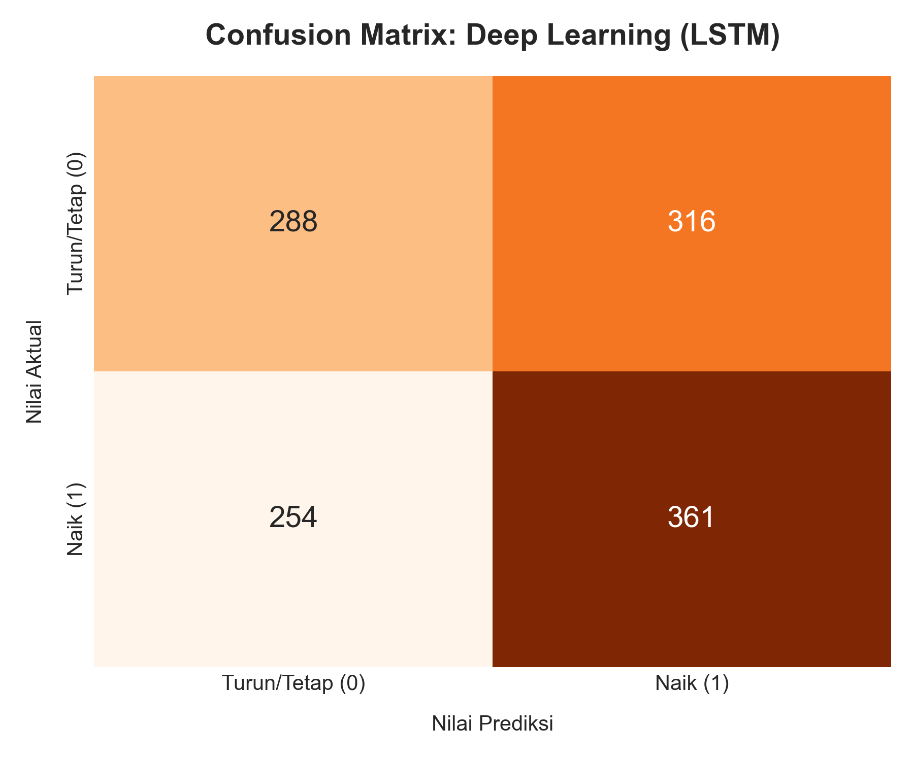
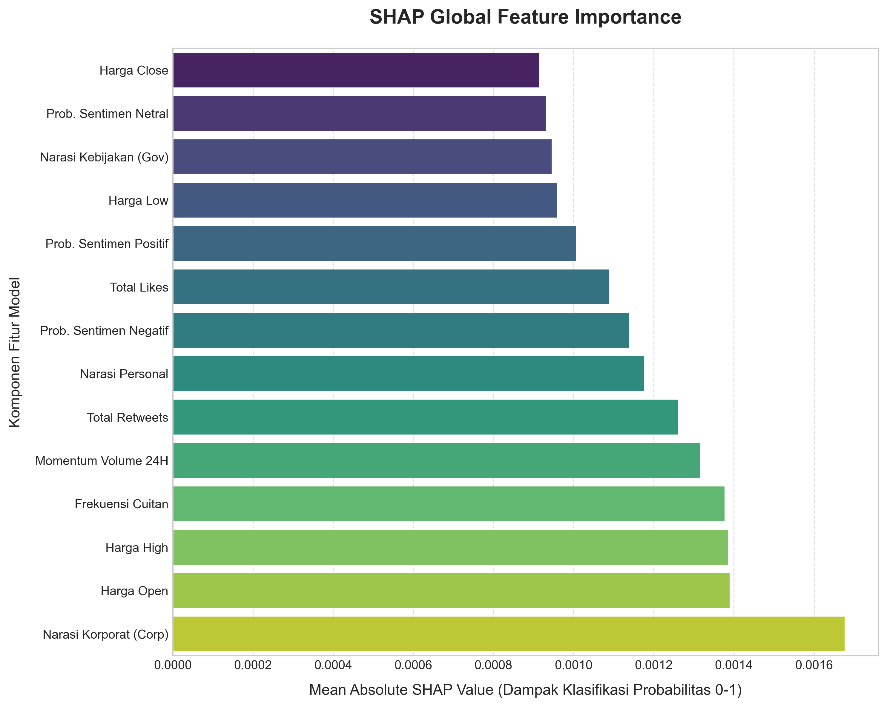
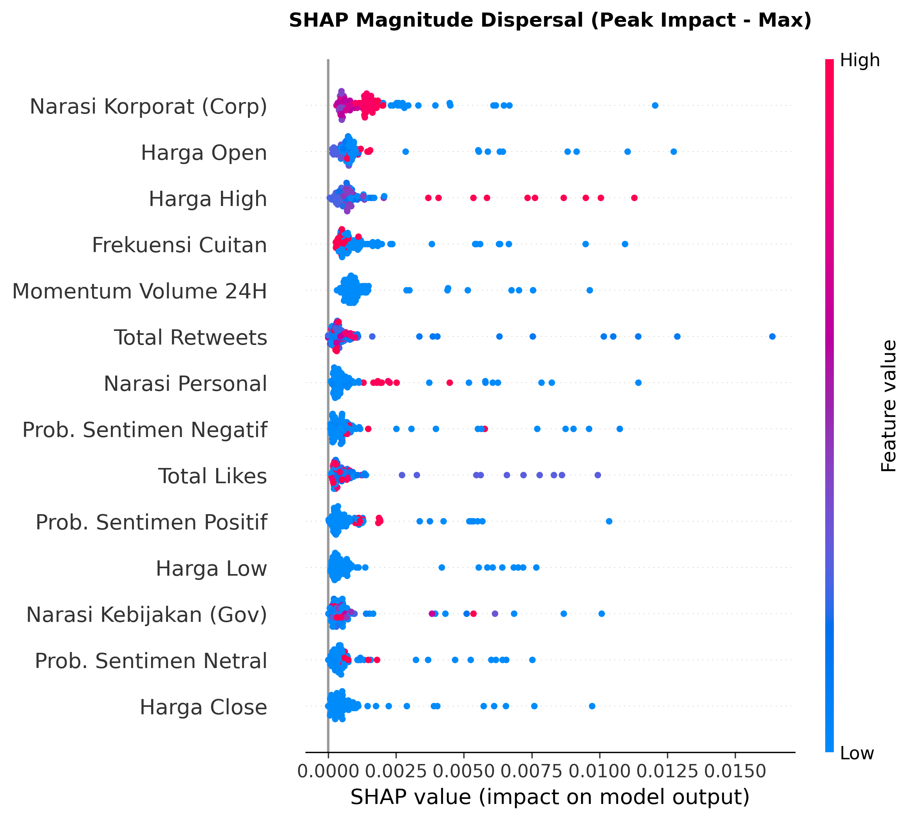

# Crypto Sentiment LSTM

> Do public figures move crypto prices? Predicting 24-hour price direction from influencer tweet sentiment with Logistic Regression and LSTM.

[](https://www.python.org/)
[](https://www.tensorflow.org/)
[](https://scikit-learn.org/)
[](https://huggingface.co/ProsusAI/finbert)
[](https://opensource.org/licenses/MIT)

## About

This project tests whether tweets from three high-profile figures — **Elon Musk, Michael Saylor, and Donald Trump** — can predict the 24-hour price direction of 10 major cryptocurrencies.

It is an end-to-end research pipeline: scrape tweets and prices, score sentiment with FinBERT, engineer features, train a Logistic Regression baseline and an LSTM, and explain the models with SHAP.

## Research Question

Can the sentiment of a public figure's tweet predict whether a crypto asset's price will go up or down in the next 24 hours?

## Data

- **Social data (2021–2025):** 2,054 tweets from Elon Musk, Michael Saylor, and Donald Trump, collected from Twitter and Truth Social with Selenium.
- **Price data:** hourly OHLCV for 10 coins from Binance — BTC, ETH, SOL, BNB, ADA, XRP, DOGE, TRX, LINK, AVAX.
- **After cleaning:** 1,680 tweets remain after macro-event filtering, aggregated into 622 24-hour events, producing a final feature set of 408,580 rows.

## Pipeline

1. **Collection** — scrape tweets (Selenium) and hourly prices (Binance API).
2. **Cleaning & temporal sync** — remove replies, URLs, mentions, and emojis; normalize text; align all timestamps to UTC.
3. **Narrative-to-asset mapping** — map each tweet to the coins it mentions (keyword dictionary + explode).
4. **Sentiment scoring** — FinBERT (`ProsusAI/finbert`) with a crypto lexicon override (`moon`, `hodl`, `bullish` / `rekt`, `rug`, `dump`) and an ambivalence rule (probability gap < 0.15 → neutral). Zero-shot classification tags each narrative as Personal, Policy-Government, or Policy-Corporate.
5. **Macro-event filtering** — drop tweets within ±24 hours of FOMC and CPI releases, so the measured signal comes from the tweets, not macro news.
6. **Feature engineering** — `Price_Runup_24H`, social features (likes, retweets, sentiment probabilities), and the target `Tren_Harga_24H` (1 if the price 24h later is higher, else 0).
7. **Baseline: Logistic Regression** — accuracy **52.39%**, recall **62.47%**.
8. **LSTM** — 3D sequences `[samples, 24, features]`, trained on Google Colab (T4 GPU). Final model: `30_STAGE6_MODEL_Final_LSTM.keras`.
9. **Explainability: SHAP** — summary and beeswarm plots show which features drive the predictions.

## Results

| Model | Accuracy | Recall |
| --- | --- | --- |
| Logistic Regression | 52.39% | 62.47% |
| LSTM | see confusion matrix below | — |







## Project Structure

Files are numbered by pipeline stage:

```
crypto-sentiment-lstm/
├── 00_HARGA_KRIPTO/              # Hourly price data (10 coins)
├── 02_STAGE1_...                 # Tweet scraper + raw data
├── 09_STAGE2_...                 # Macro-event filter
├── 11_STAGE3_...                 # Text preprocessing
├── 13-18_STAGE4_...              # Asset mapping, sentiment scoring, narrative tagging
├── 21-24_STAGE5_...              # Logistic Regression training + results
├── 25-31_STAGE6_...              # LSTM data prep, training, model, results
├── 32-34_STAGE7_...              # SHAP analysis + plots
└── 01_INFO_Alur_Penelitian.md   # Full technical documentation (Indonesian)
```

## Reproducing

- Python 3.10+
- Core libraries: pandas, scikit-learn, TensorFlow/Keras, transformers (FinBERT), SHAP
- LSTM training was run on Google Colab with a T4 GPU — see `26_STAGE6_CODE_Train_LSTM.py`

## Disclaimer

Research project for educational purposes. Not financial advice.

## License

MIT — free to use and modify.

---

Built by [Fathir Anugrah](https://github.com/fathiranugrahh) · [fathiranugrah.com](https://fathiranugrah.com)

## License

This project is licensed under the MIT License.

